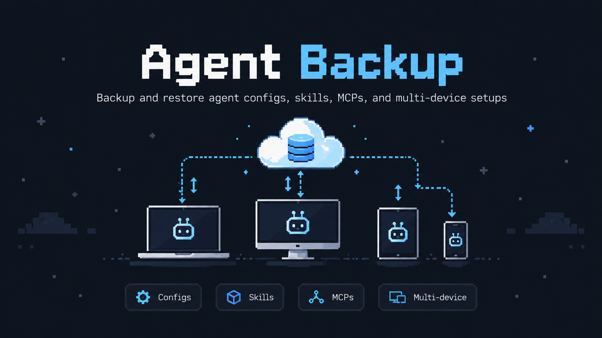

# agent-backup

Encrypted backups of your AI agent setups (Claude Code, Codex, Gemini CLI, opencode, Cursor, Hermes)
and home servers, with a restore that puts them back on any machine.

- Install: `npm install -g agent-backup` (or run `npx agent-backup scan`)
- Source code and documentation: [github.com/saiteja007-mv/agent-backup](https://github.com/saiteja007-mv/agent-backup)
- Full guide: [GUIDE](https://github.com/saiteja007-mv/agent-backup/blob/main/docs/GUIDE.md)
- Package: [npmjs.com/package/agent-backup](https://www.npmjs.com/package/agent-backup)
- Privacy policy: [privacy](privacy.html)

agent-backup is open source (MIT). It runs entirely on your own computers; there is no agent-backup
server or account.
